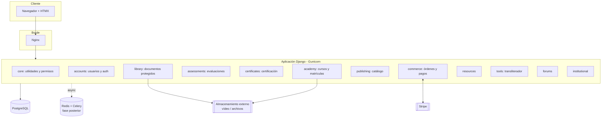
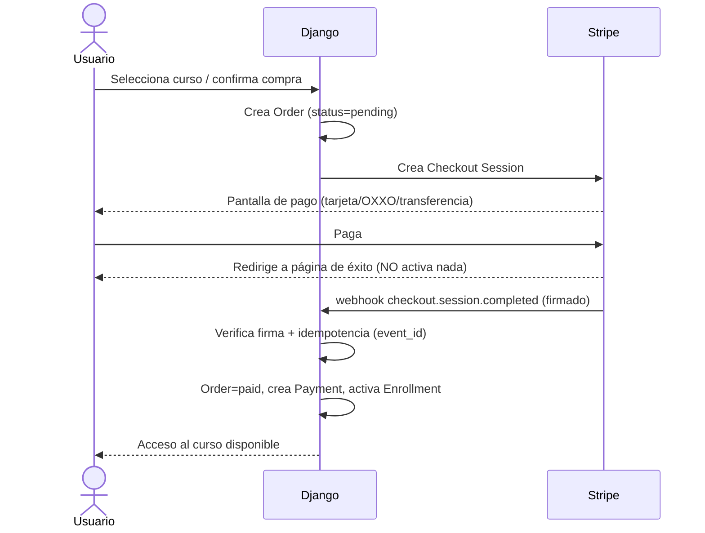
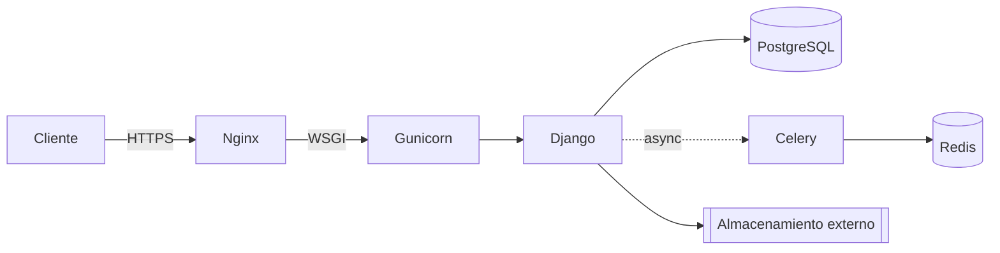

# 2. Documento de Arquitectura Técnica — Instituto Vak Advaita (IVA)

**Versión:** 0.3 (revisada)  
**Estado:** base para implementación  
**Estilo arquitectónico:** monolito modular (Django)

---

## 2.1. Propósito y alcance

El IVA es una plataforma educativa que vende cursos en línea y libros digitales
(y luego físicos) bajo sello propio, y ofrece biblioteca virtual, herramientas
de aprendizaje y recursos de investigación. Este documento define la
arquitectura técnica de referencia: estructura, decisiones, atributos de calidad
y hoja de ruta.

## 2.2. Drivers arquitectónicos

| Driver | Implicación |
|---|---|
| Equipo pequeño, iteración rápida | Monolito modular, no microservicios |
| Contenido multilingüe (es/ca/pt) + sánscrito | i18n y Unicode desde el inicio |
| Pagos nacionales e internacionales | Stripe Checkout, MXN base, webhooks |
| Contenido protegido (PDF, vídeo) | Endpoints autenticados, trazabilidad |
| Certificación verificable | ID único + página pública de verificación |

## 2.3. Estilo arquitectónico: monolito modular

Se elige un **monolito modular**: un núcleo común y módulos de negocio
independientes a nivel conceptual, desplegados como una única aplicación.

**Por qué no microservicios (todavía):** el coste operativo (despliegue, red,
observabilidad distribuida, consistencia) no se justifica con el tamaño actual
del equipo ni del tráfico. El monolito modular conserva fronteras de dominio
limpias y permite extraer un servicio *si y cuando* exista una razón real
(escala de un módulo, equipo dedicado, aislamiento de fallos).

**Cómo se conservan las fronteras:** una app de Django por dominio, dependencias
dirigidas (los módulos de negocio dependen de `core` y `accounts`, no al revés)
y la lógica de negocio en servicios (`services.py`), no en vistas.

## 2.4. Vista de componentes (lógica)

## 2.5. Vista de módulos (dominios)

| App | Responsabilidad | Depende de |
|---|---|---|
| `core` | Mixins, utilidades, permisos centralizados | — |
| `accounts` | `User` por email, perfiles, autenticación | core |
| `academy` | Cursos, módulos, lecciones, recursos, matrículas, progreso | core, accounts, commerce |
| `assessments` | Quizzes, preguntas, opciones, intentos | core, accounts, academy |
| `certificates` | Emisión y verificación de certificados | core, academy |
| `commerce` | Carrito, órdenes, pagos, reembolsos, envíos, webhooks | core, accounts, academy, publishing |
| `publishing` | Catálogo editorial (libro digital/físico/ambos) | core |
| `library` | Colecciones, documentos, descargas protegidas | core, accounts |
| `resources` | Materiales educativos descargables | core |
| `tools` | Transliterador devanāgarī→IAST, memorama, tarjetas | core |
| `forums` | Hilos y mensajes por lección | core, accounts, academy |
| `institutional` | Home, historia, misión, legales | core |

**Regla de dependencias:** el sentido de las flechas nunca se invierte. Si
`commerce` necesitara avisar a `academy` para activar una matrícula, lo hace
llamando a un servicio público de `academy` (`activate_enrollment`), no al revés.

## 2.6. Vista de datos

El modelo de datos completo está en `03_diagrama_entidad_relacion.md` y en
`er_diagram.png`. Entidades principales por dominio:

- **academy:** `Course → CourseModule → Lesson → LessonResource`;
  `Enrollment` (usuario×curso con verificación de pago) y `LessonProgress`.
- **assessments:** `Quiz → Question → AnswerOption`, `QuizAttempt`.
- **certificates:** `Certificate` (1:1 con `Enrollment`, `public_id` único).
- **commerce:** `Cart`, `Order → OrderItem`, `Payment → Refund`, `ShippingDetail`,
  `ProcessedWebhookEvent`.
- **publishing:** `Product → {DigitalBook, PhysicalBook}`.
- **library:** `Collection → Document`, `DownloadLog`.

**Invariantes de datos relevantes:**
- Una sola matrícula **activa** por par usuario–curso (constraint parcial).
- El dinero siempre en `DecimalField` + moneda explícita en la orden.
- Relaciones contables con `on_delete=PROTECT`; preferir borrado lógico.

## 2.7. Pila tecnológica y justificación

| Capa | Tecnología | Por qué |
|---|---|---|
| Backend | Django | Admin, auth, ORM y migraciones maduros; productividad alta |
| Base de datos | PostgreSQL | Integridad, constraints parciales, Unicode, transacciones |
| Frontend | Django Templates + HTMX | Interactividad sin la complejidad de un SPA |
| Diseño | Tailwind CSS | Sistema visual responsive y reutilizable |
| Pagos | Stripe Checkout | Menos UI de pago propia, menos datos bancarios en casa |
| Asíncrono | Redis + Celery | Notificaciones y tareas programadas (fase posterior) |
| PDFs | PyMuPDF / PDF.js | Procesado servidor + visor in situ |
| Certificados | WeasyPrint | HTML→PDF con control de diseño |
| Imágenes | Pillow | Procesado de avatares y portadas |
| Testing | Pytest + pytest-django | Pruebas de reglas de negocio |
| Servidor/App | Nginx + Gunicorn | Estándar de despliegue WSGI |
| Contenedores | Docker + Compose | Entornos reproducibles |

Las dependencias se instalan **cuando hay necesidad real** (Celery, Redis y DRF
pueden esperar). Se evita cargar el proyecto con infraestructura prematura.

## 2.8. Aspectos transversales

### 2.8.1. Autenticación y usuarios
- `User` **personalizado por email desde el inicio** (`accounts.User`), para no
  pagar después el coste de cambiar el modelo de usuario.
- Estados del usuario: anónimo, registrado, inscrito, staff, instructor.
- **"Inscrito" es calculado** (`User.is_enrolled` consulta matrículas activas),
  nunca un rol persistente.

### 2.8.2. Autorización (matriz de permisos)
- La comprobación ocurre **siempre en el servidor**; la UI solo oculta/muestra.
- Centralizada en `core/permissions.py` (`can_access_course`,
  `can_download_library_item`). Toda descarga pasa por una verificación.

| Recurso | Anónimo | Registrado | Inscrito |
|---|---|---|---|
| Home / institucional | Sí | Sí | Sí |
| Catálogo | Sí | Sí | Sí |
| Lección de muestra | No | Sí | Sí |
| Lecciones completas | No | Muestra | Según matrícula |
| Biblioteca (completa) | No | Limitada | Completa |
| Certificados | No | No | Propios |

### 2.8.3. Pagos y activación de matrícula
Flujo (ver secuencia abajo). **Regla indispensable:** la matrícula se activa
sólo tras **recibir y verificar el webhook**, nunca por el retorno a la página
de éxito. El procesamiento es **idempotente** (`ProcessedWebhookEvent` con
`event_id` único, transacción atómica y `select_for_update`).

**Moneda:** MXN como base para precios mexicanos. Stripe ofrece tarjeta, OXXO y
transferencia para cuentas MX con restricciones de moneda; hay que validar la
configuración de la cuenta y los métodos disponibles para compradores
extranjeros. Guardar importe y moneda tal como los confirma Stripe.

### 2.8.4. Protección de contenidos (biblioteca)
Tres niveles: (1) biblioteca para registrados con cuotas y registro; (2)
colecciones completas para inscritos; (3) lectura in situ con PDF.js sobre
endpoints protegidos y marca de agua personalizada cuando sea posible. Objetivo
realista: **controlar el acceso, auditar y disuadir**, no un DRM infranqueable.

### 2.8.5. Internacionalización
- `gettext` para la interfaz; contenido académico separado de las plantillas.
- UTF-8 en toda la infraestructura; PostgreSQL para Unicode.
- Contenido académico en cuatro capas: devanāgarī original, transliteración
  IAST (ā ī ū ṛ ṝ ṃ ḥ ś ṣ ñ ṅ ṭ ḍ), traducción (es/ca/pt) y comentario.
- Transliterador en `tools/transliteration.py`.

## 2.9. Vista de despliegue

- Contenedores con Docker; `web` + `db` en Compose para desarrollo.
- Configuración por entorno (`base`/`development`/`production`); secretos por
  variables de entorno, nunca en el código.
- Producción: HTTPS forzado, HSTS, cookies seguras, `collectstatic`.

## 2.10. Atributos de calidad

| Atributo | Cómo se aborda |
|---|---|
| Seguridad | Auth en servidor, CSRF, firma de webhooks, secretos en entorno |
| Mantenibilidad | Fronteras de dominio, lógica en servicios, tests de reglas |
| Integridad de datos | Constraints, `PROTECT`, decimales, idempotencia |
| Internacionalización | gettext, UTF-8, modelo de contenido multilenguaje |
| Escalabilidad | Caché/async con Redis+Celery cuando haya necesidad real |
| Observabilidad (pendiente) | Logging estructurado, healthcheck, backups |

## 2.11. Riesgos y mitigaciones

| Riesgo | Mitigación |
|---|---|
| Webhooks duplicados / fuera de orden | Idempotencia por `event_id` + transacción |
| Fuga de PDF | Marca de agua, URL firmada corta, cuota, registro |
| Definición ambigua de "Lab" | Modelar `Lab` con estados antes de certificar por él |
| Errores de moneda/redondeo | Decimales, moneda explícita, montos de Stripe |
| Pérdida de datos contables | `PROTECT` + borrado lógico + backups |

## 2.12. Hoja de ruta por fases

1. **Fase 1 (MVP):** accounts, academy, commerce+Stripe, certificates,
   institutional. Base de la venta y el consumo de cursos.
2. **Fase 2:** library (3 niveles), publishing (digital), assessments completos.
3. **Fase 3:** Redis+Celery (notificaciones, tareas), DRF (API), tools avanzadas
   (memorama, tarjetas), libros físicos (inventario y envíos).
4. **Fase 4:** observabilidad, optimización, posible extracción de un módulo a
   servicio si la escala lo exige.
