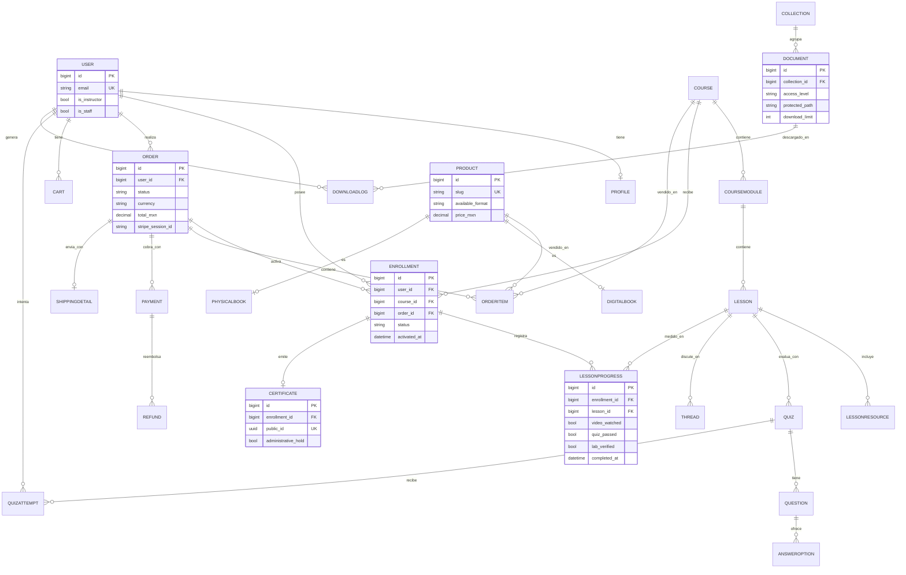

# 3. Diagrama Entidad-Relación — IVA

Imagen renderizada: `er_diagram.png` (en esta misma carpeta).  
Abajo, la fuente autoritativa en Mermaid (`erDiagram`), que se puede editar y
volver a renderizar.

## 3.1. Cardinalidades resumidas

- Un `Course` tiene muchos `CourseModule`; un módulo, muchas `Lesson`.
- Una `Lesson` tiene muchos `LessonResource` (vídeo, PDF, quiz, lab, foro).
- Un `User` tiene muchas `Enrollment`; cada `Enrollment` es de un `Course` y se
  liga a la `Order` que verificó su pago.
- Cada `Enrollment` tiene su propio `LessonProgress` por lección.
- Un `Certificate` pertenece a una `Enrollment` concreta (1:1), con `public_id`.
- `Order` → muchos `OrderItem`; `Order` → muchos `Payment`; `Payment` → `Refund`.
- `Product` se especializa en `DigitalBook` o `PhysicalBook` (1:1).
- `Collection` → muchos `Document`; cada descarga queda en `DownloadLog`.

## 3.2. Mermaid (erDiagram)

> Notación: `||--o{` = uno-a-muchos, `||--o|` = uno-a-uno/opcional,
> `PK` = clave primaria, `FK` = clave foránea, `UK` = única.
